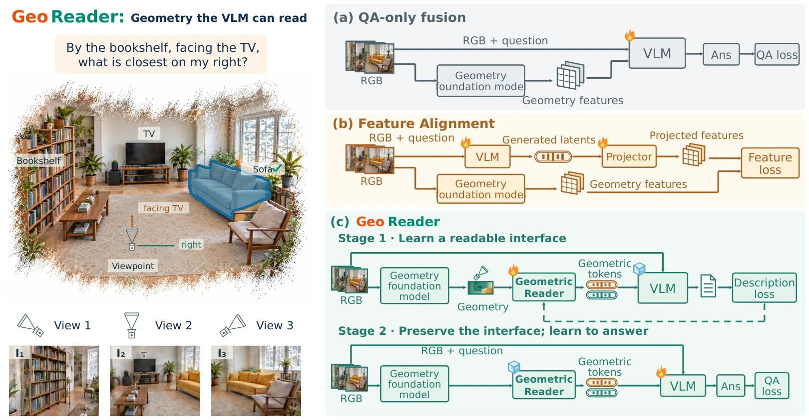
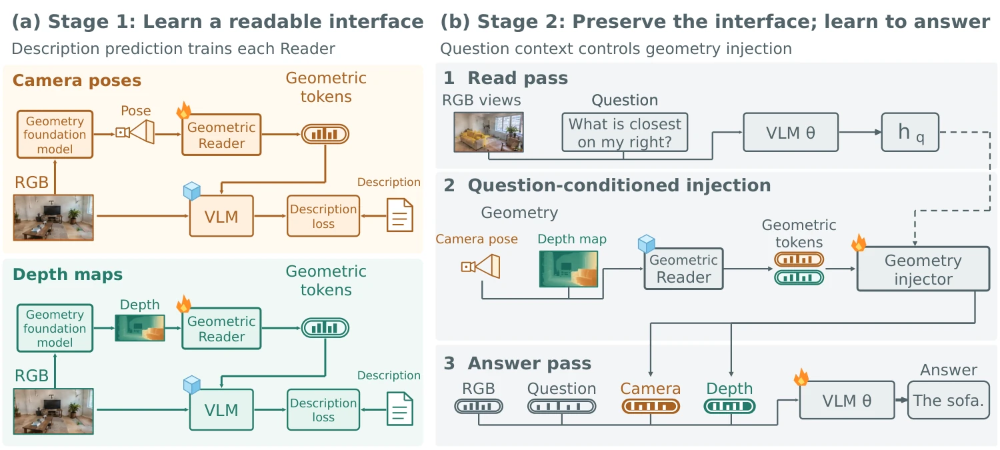
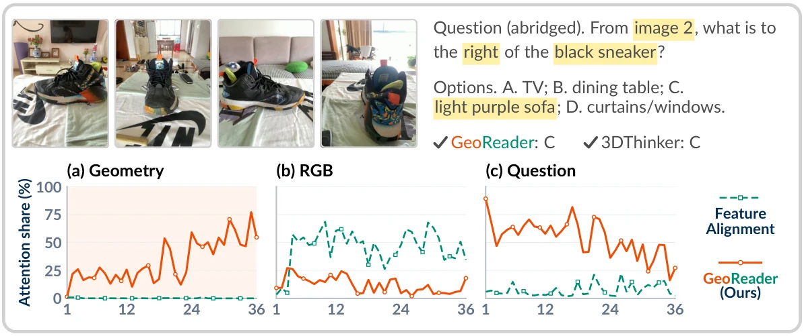
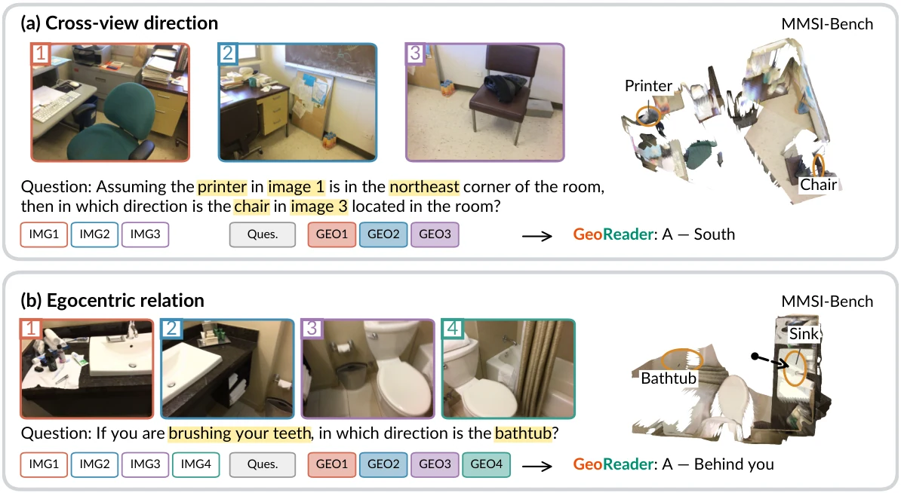
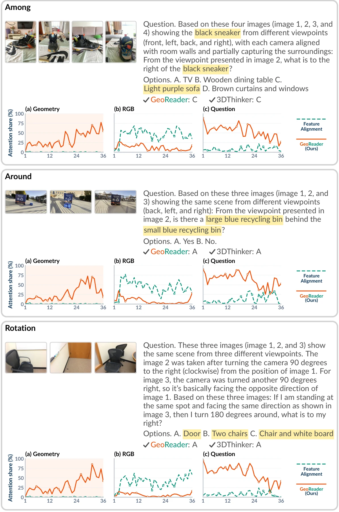
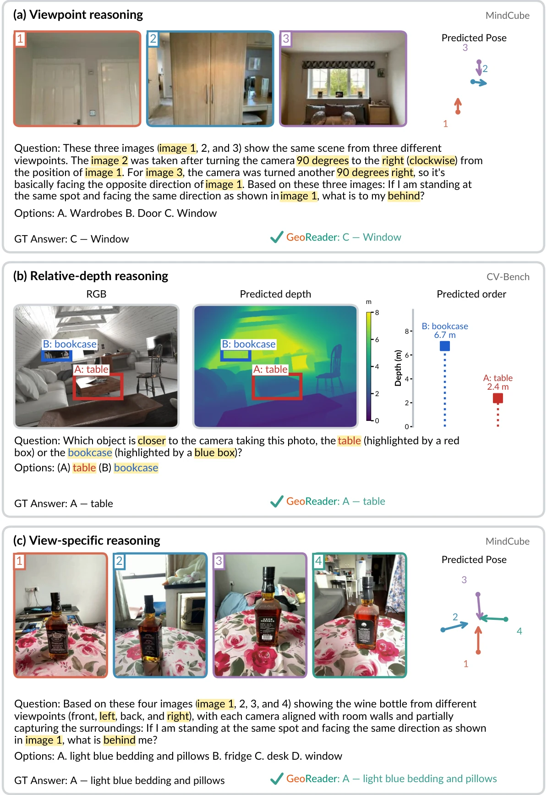
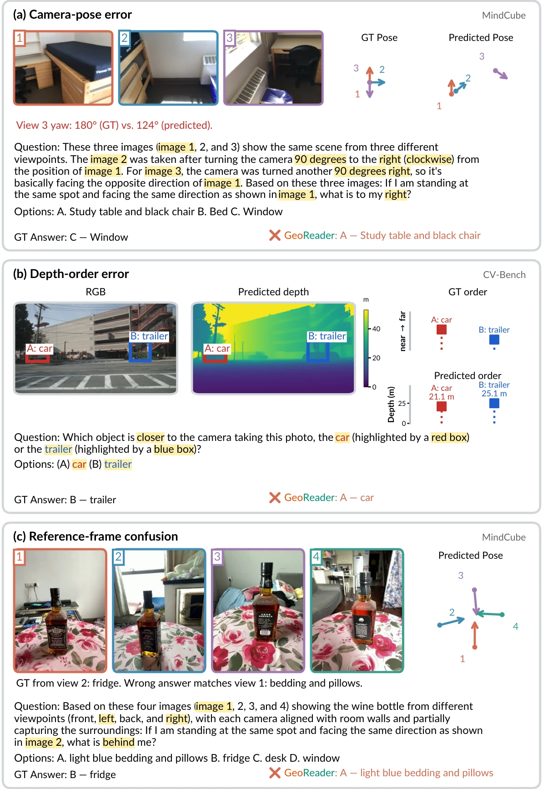
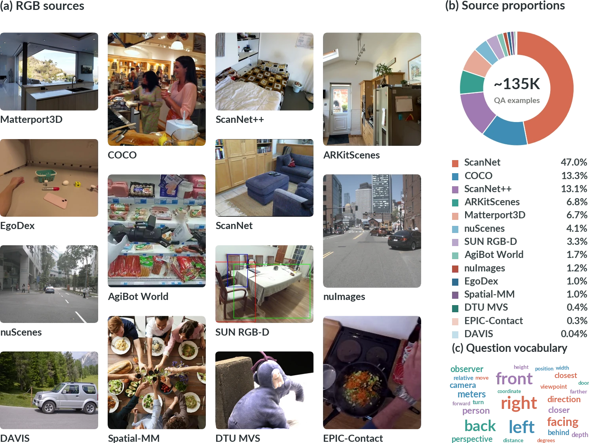

<h1 align="center">GeoReader: Learning Latent Geometry for Spatial Reasoning in Vision-Language Models</h1>

<p align="center">
  <a href="https://iris0329.github.io/">Rong Li</a><sup>1,6*</sup> ·
  <a href="https://sj-li.com/">Shijie Li</a><sup>2*</sup> ·
  <a href="https://huangjy-pku.github.io/">Jiangyong Huang</a><sup>3,6</sup> ·
  <a href="https://ldkong.com/">Lingdong Kong</a><sup>4</sup> ·
  <a href="https://jiaming-zhou.github.io/">Jiaming Zhou</a><sup>1</sup><br>
  <a href="https://dylanorange.github.io/">Dongyue Lu</a><sup>4</sup> ·
  <a href="https://zeying-gong.github.io/">Zeying Gong</a><sup>1</sup> ·
  <a href="https://buzz-beater.github.io/">Baoxiong Jia</a><sup>6†✉</sup> ·
  <a href="https://junweiliang.me/">Junwei Liang</a><sup>1,5✉</sup> ·
  <a href="https://siyuanhuang.com/">Siyuan Huang</a><sup>6✉</sup>
</p>

<p align="center">
  <sup>1</sup>The Hong Kong University of Science and Technology (Guangzhou) &nbsp;·&nbsp; <sup>2</sup>Agency for Science, A*STAR<br>
  <sup>3</sup>Peking University &nbsp;·&nbsp; <sup>4</sup>National University of Singapore<br>
  <sup>5</sup>The Hong Kong University of Science and Technology &nbsp;·&nbsp; <sup>6</sup>Beijing Institute for General Artificial Intelligence<br>
  <sup>*</sup>Equal contribution &nbsp;·&nbsp; <sup>†</sup>Project lead &nbsp;·&nbsp; <sup>✉</sup>Corresponding authors
</p>

<p align="center">
  &nbsp;&nbsp;
  &nbsp;&nbsp;
  &nbsp;&nbsp;
  &nbsp;&nbsp;
  
</p>

<p align="center">
  <a href="https://iris0329.github.io/georeader-homepage/"><strong>🌐 Project Page</strong></a>
  &nbsp;·&nbsp; 📄 arXiv (coming soon)
</p>

<p align="center">
  
</p>

Geometry foundation models can recover 3D structure from RGB views, but geometric features alone do not ensure that a vision-language model uses them to answer questions. **GeoReader** learns geometric tokens that the model can read and use for spatial reasoning.

## Method

GeoReader first trains Geometric Readers to express predicted geometry through a frozen VLM. It then freezes the Readers and learns question-conditioned geometry injection for spatial QA. Geometry descriptions supervise training; inference uses continuous geometric tokens.

<p align="center">
  
</p>

## Visualizations

**Answer-token attention.** Figure 3 compares attention to geometric, RGB, and question tokens.

<p align="center">
  
</p>

**Spatial reasoning.** Figure 4 shows cross-view questions answered with geometry predicted from RGB views; the point clouds come from predicted depth.

<p align="center">
  
</p>

<details>
<summary><strong>More visualizations</strong> — supplementary Figures 9–11</summary>

**Figure 9 · Answer-token attention across question types**



**Figure 10 · More correct examples**



**Figure 11 · Failure cases**



</details>

## Training data

<p align="center">
  
</p>

## Release status

Coming soon.

## Citation

```bibtex
@misc{li2026georeader,
  title  = {{GeoReader}: Learning Latent Geometry for Spatial Reasoning in Vision-Language Models},
  author = {Rong Li and Shijie Li and Jiangyong Huang and Lingdong Kong and Jiaming Zhou and Dongyue Lu and Zeying Gong and Baoxiong Jia and Junwei Liang and Siyuan Huang},
  year   = {2026}
}
```
