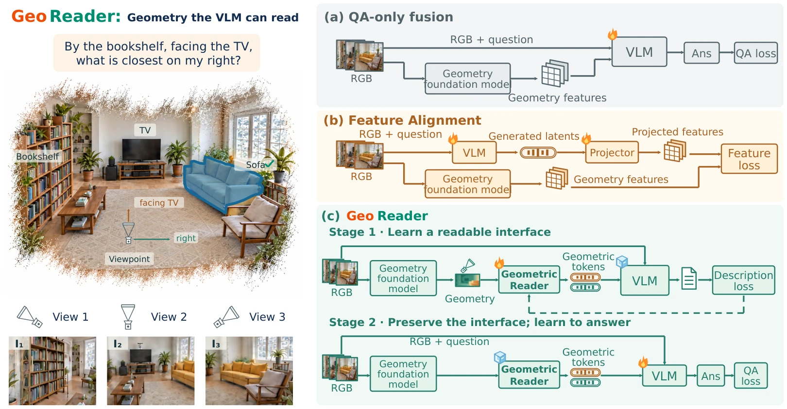
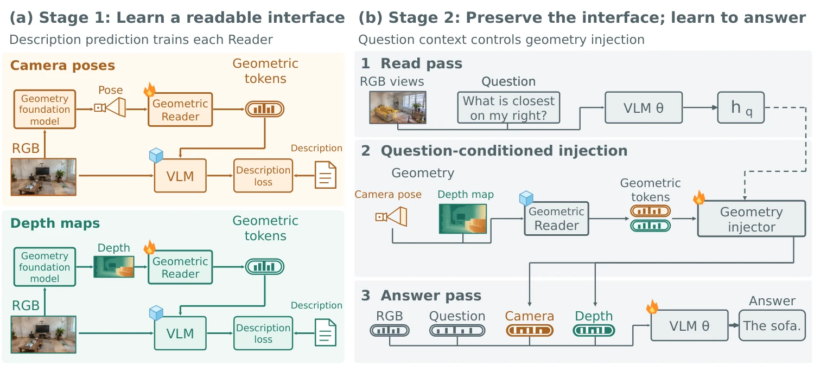
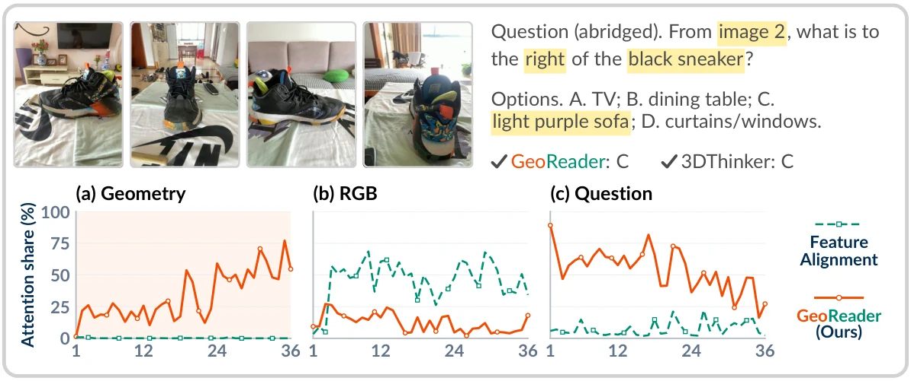
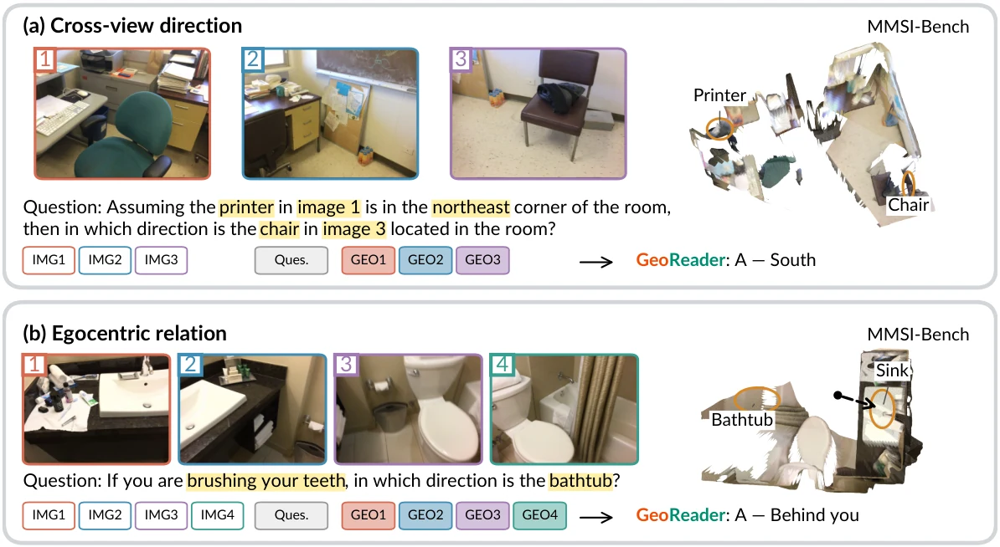
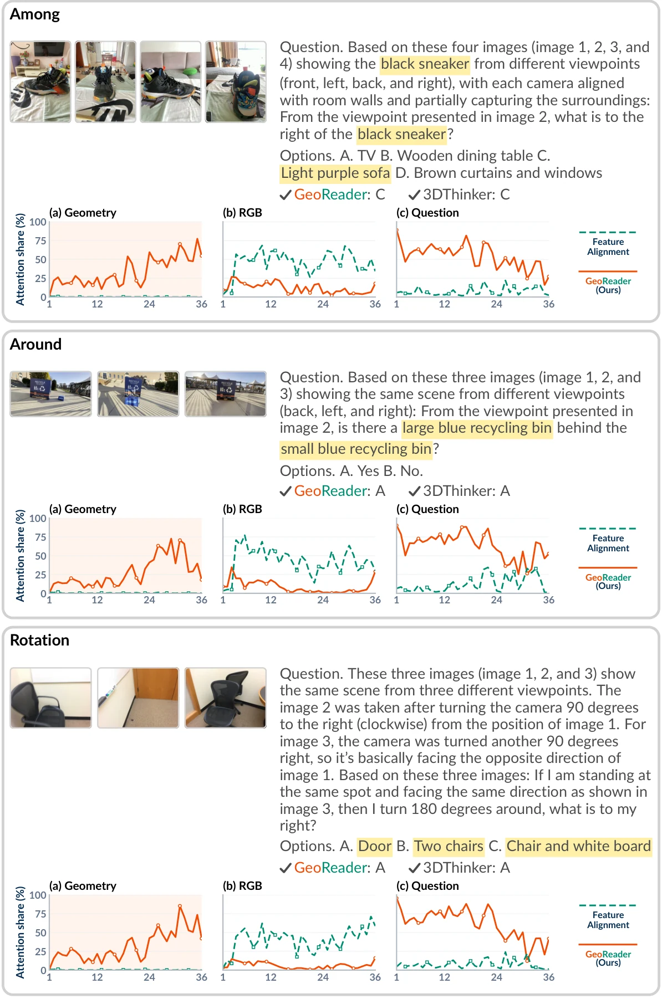
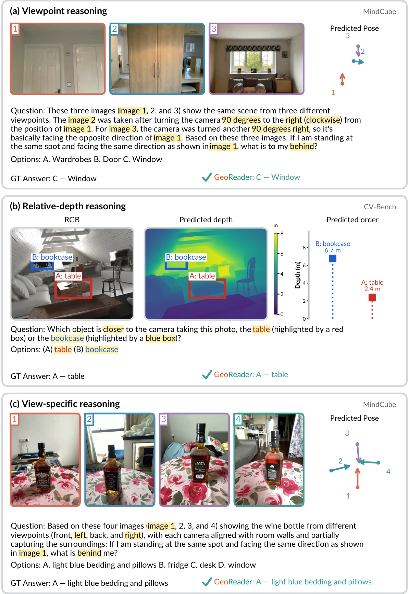
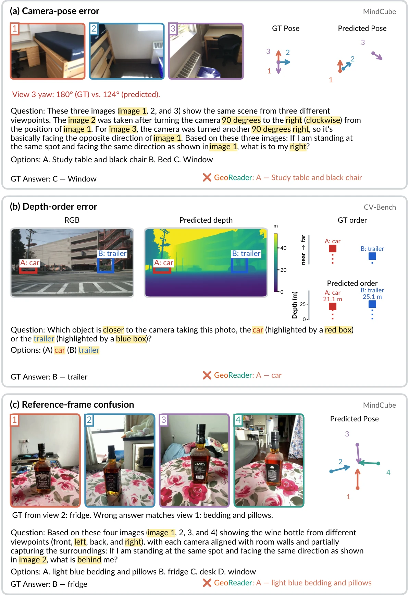
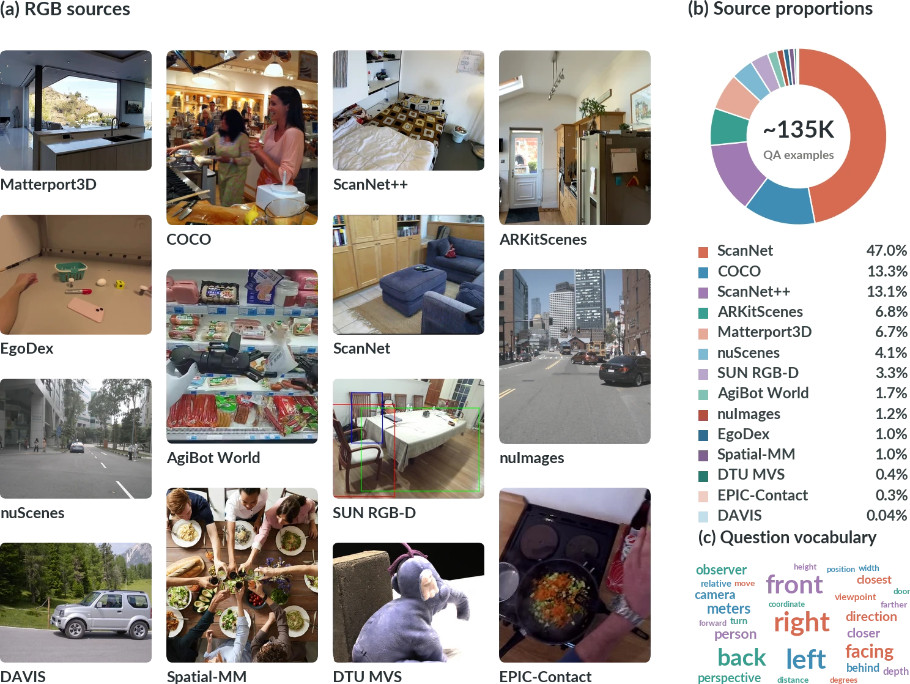

<h1 align="center">GeoReader: Learning Latent Geometry for Spatial Reasoning in Vision-Language Models</h1>

<p align="center">
  <a href="https://iris0329.github.io/">Rong Li</a><sup>1,6*</sup> ·
  <a href="https://sj-li.com/">Shijie Li</a><sup>2*</sup> ·
  <a href="https://huangjy-pku.github.io/">Jiangyong Huang</a><sup>3,6</sup> ·
  <a href="https://ldkong.com/">Lingdong Kong</a><sup>4</sup> ·
  <a href="https://jiaming-zhou.github.io/">Jiaming Zhou</a><sup>1</sup><br>
  <a href="https://dylanorange.github.io/">Dongyue Lu</a><sup>4</sup> ·
  <a href="https://zeying-gong.github.io/">Zeying Gong</a><sup>1</sup> ·
  <a href="https://buzz-beater.github.io/">Baoxiong Jia</a><sup>6†✉</sup> ·
  <a href="https://junweiliang.me/">Junwei Liang</a><sup>1,5✉</sup> ·
  <a href="https://siyuanhuang.com/">Siyuan Huang</a><sup>6✉</sup>
</p>

<p align="center">
  <sup>1</sup>The Hong Kong University of Science and Technology (Guangzhou) &nbsp;·&nbsp; <sup>2</sup>Agency for Science, A*STAR<br>
  <sup>3</sup>Peking University &nbsp;·&nbsp; <sup>4</sup>National University of Singapore<br>
  <sup>5</sup>The Hong Kong University of Science and Technology &nbsp;·&nbsp; <sup>6</sup>Beijing Institute for General Artificial Intelligence<br>
  <sup>*</sup>Equal contribution &nbsp;·&nbsp; <sup>†</sup>Project lead &nbsp;·&nbsp; <sup>✉</sup>Corresponding authors
</p>

<p align="center">
  &nbsp;&nbsp;
  &nbsp;&nbsp;
  &nbsp;&nbsp;
  &nbsp;&nbsp;
  
</p>

<p align="center">
  <a href="https://iris0329.github.io/georeader-homepage/"></a>
  &nbsp;
  <a href="https://arxiv.org/abs/2610.18694"></a>
</p>

<p align="center">
  
</p>

Geometry foundation models can recover 3D structure from RGB views, but geometric features alone do not ensure that a vision-language model uses them to answer questions. **GeoReader** learns geometric tokens that the model can read and use for spatial reasoning.

## Contents

- [1. Method](#1-method)
- [2. Results](#2-results)
- [3. Models and data](#3-models-and-data)
- [4. Install](#4-install)
- [5. MindCube with Qwen2.5-VL-3B](#5-mindcube-with-qwen25-vl-3b)
  - [5.1 Train](#51-train)
  - [5.2 Evaluate](#52-evaluate)
- [6. Six benchmarks with Qwen3-VL-8B](#6-six-benchmarks-with-qwen3-vl-8b)
  - [6.1 Train](#61-train)
  - [6.2 Evaluate](#62-evaluate)
- [7. Generate data](#7-generate-data)
- [8. Acknowledgments](#8-acknowledgments)
- [9. Citation](#9-citation)

## 1. Method

GeoReader first trains Geometric Readers to express predicted geometry through a frozen VLM. It then freezes the Readers and learns question-conditioned geometry injection for spatial QA. Geometry descriptions supervise training; inference uses continuous geometric tokens.

<p align="center">
  
</p>

## 2. Results

Accuracy (%). GeoReader numbers come from the released checkpoints. In each table,
Vanilla SFT is trained on the same QA with the same settings, without geometry.

**MindCube-Tiny, Qwen2.5-VL-3B.**

| Category | Vanilla SFT | GeoReader | Gain |
|:--|:--:|:--:|:--:|
| Rotation | 58.50 | **60.50** | +2.00 |
| Among | 71.67 | **93.83** | +22.16 |
| Around | 69.20 | **92.40** | +23.20 |
| **Overall** | 68.57 | **87.14** | **+18.57** |

**Six benchmarks, Qwen3-VL-8B.** The mean gives equal weight to the six official
benchmark metrics.

| Benchmark | Vanilla SFT | GeoReader | Gain |
|:--|:--:|:--:|:--:|
| VSI-Bench | 60.81 | **66.20** | +5.39 |
| SPBench | 69.01 | **76.72** | +7.71 |
| CV-Bench | 79.24 | **86.53** | +7.29 |
| SPAR-Bench | 60.48 | **65.71** | +5.23 |
| ViewSpatial | 76.09 | **78.52** | +2.43 |
| MMSI-Bench | 40.90 | **46.60** | +5.70 |
| **Mean** | 64.42 | **70.05** | **+5.63** |

**Answer-token attention.** Figure 3 compares attention to geometric, RGB, and question tokens.

<p align="center">
  
</p>

**Spatial reasoning.** Figure 4 shows cross-view questions answered with geometry predicted from RGB views; the point clouds come from predicted depth.

<p align="center">
  
</p>

<details>
<summary><strong>More visualizations</strong> — supplementary Figures 9–11</summary>

**Figure 9 · Answer-token attention across question types**



**Figure 10 · More correct examples**



**Figure 11 · Failure cases**



</details>

## 3. Models and data

Two independent recipes, each with its own model and data on Hugging Face:

| Recipe | Base model | Model | Data |
|:--|:--|:--:|:--:|
| **MindCube** | Qwen2.5-VL-3B-Instruct | [](https://huggingface.co/RRRong/GeoReader-Qwen2.5-VL-3B-MindCube) | [](https://huggingface.co/datasets/RRRong/GeoReader-MindCube) |
| **Six benchmarks** | Qwen3-VL-8B-Instruct | [](https://huggingface.co/RRRong/GeoReader-Qwen3-VL-8B) | [](https://huggingface.co/datasets/RRRong/GeoReader-MultiSource) |

Six-benchmark training QA examples:

<p align="center">
  
</p>

## 4. Install

Create a Python 3.10 environment with PyTorch 2.6.0 (CUDA 12.4) and the pinned
Transformers version in `requirements.txt`. Install PyTorch before the remaining
dependencies:

```bash
conda create -n georeader python=3.10 -y
conda activate georeader
pip install torch==2.6.0 torchvision==0.21.0 --index-url https://download.pytorch.org/whl/cu124
pip install -r requirements.txt
# Needed for Vanilla SFT training; build it against your installed CUDA and PyTorch.
pip install flash-attn==2.7.4.post1 --no-build-isolation
```

Run all commands from the repository root. Multi-GPU training writes large temporary
files, so point `TMPDIR` to a disk with enough free space:

```bash
export TMPDIR=/path/to/large/tmp
```

## 5. MindCube with Qwen2.5-VL-3B

This recipe has separate data, geometry and Reader weights. Download the data
package, the released model (which also provides the Stage 1 Reader) and the base
model:

```bash
hf download RRRong/GeoReader-MindCube --repo-type dataset \
  --local-dir datasets/GeoReader-MindCube
tar -xf datasets/GeoReader-MindCube/archives/mindcube.tar \
  -C datasets/GeoReader-MindCube
hf download RRRong/GeoReader-Qwen2.5-VL-3B-MindCube \
  --local-dir models/GeoReader-Qwen2.5-VL-3B-MindCube
hf download Qwen/Qwen2.5-VL-3B-Instruct --local-dir models/Qwen2.5-VL-3B-Instruct
```

### 5.1 Train

The released model starts Stage 2 from the supplied Reader at `stage1/camera/`, so
Stage 1 is optional. Training uses the official 10K answer-only QA for 10 epochs on
one GPU, with batch size 1 and gradient accumulation 1. Settings are in
[the MindCube config](configs/mindcube_da3_qwen25_3b/recipe.json).

Optional Stage 1 on the supplied 3,375 description pairs:

```bash
python train_stage1.py --recipe mindcube_da3_qwen25_3b --branch camera \
  --base-model models/Qwen2.5-VL-3B-Instruct --data-root datasets/GeoReader-MindCube \
  --output-dir outputs/mindcube-stage1
```

Stage 2:

```bash
python train_stage2.py --recipe mindcube_da3_qwen25_3b --method georeader \
  --base-model models/Qwen2.5-VL-3B-Instruct --data-root datasets/GeoReader-MindCube \
  --camera-reader models/GeoReader-Qwen2.5-VL-3B-MindCube/stage1/camera \
  --output-dir outputs/mindcube-stage2
```

To use your own Stage 1 Reader, set `--camera-reader outputs/mindcube-stage1/checkpoint-8440`.

### 5.2 Evaluate

```bash
python evaluate.py --recipe mindcube_da3_qwen25_3b \
  --checkpoint outputs/mindcube-stage2/checkpoint-100000 \
  --data-root datasets/GeoReader-MindCube --benchmark mindcube \
  --output-dir outputs/mindcube-eval
```

To evaluate the released model, set `--checkpoint models/GeoReader-Qwen2.5-VL-3B-MindCube`.

## 6. Six benchmarks with Qwen3-VL-8B

Download the full dataset, the base model and the released model. The extracted
dataset is approximately 216 GB; retaining its archives requires additional space.
See the [data card](https://huggingface.co/datasets/RRRong/GeoReader-MultiSource)
for the full directory tree.

```bash
hf download RRRong/GeoReader-MultiSource --repo-type dataset \
  --local-dir datasets/GeoReader-MultiSource
for archive in datasets/GeoReader-MultiSource/archives/*.tar; do
  tar -xf "$archive" -C datasets/GeoReader-MultiSource
done
hf download Qwen/Qwen3-VL-8B-Instruct --local-dir models/Qwen3-VL-8B-Instruct
hf download RRRong/GeoReader-Qwen3-VL-8B \
  --local-dir models/GeoReader-Qwen3-VL-8B
```

### 6.1 Train

To skip Stage 1, set both `--camera-reader` and `--depth-reader` to
`models/GeoReader-Qwen3-VL-8B`. The loader extracts the released Readers and
initializes the VLM and injector for training.

**Stage 1.** Train the Readers separately on the supplied GT geometry descriptions.
Both runs use four GPUs, batch size 1 per GPU and gradient accumulation 1 for 10
epochs. The depth entrypoint prepares its per-frame training representation
automatically.

```bash
torchrun --standalone --nproc_per_node=4 train_stage1.py --branch camera \
  --base-model models/Qwen3-VL-8B-Instruct --data-root datasets/GeoReader-MultiSource \
  --output-dir outputs/stage1-camera

torchrun --standalone --nproc_per_node=4 train_stage1.py --branch depth \
  --base-model models/Qwen3-VL-8B-Instruct --data-root datasets/GeoReader-MultiSource \
  --output-dir outputs/stage1-depth
```

**Stage 2.** GeoReader and Vanilla SFT use the same 135,399 QA for two epochs on
four GPUs, with batch size 1 per GPU and gradient accumulation 2 (effective batch
size 8). Settings are in [the sixbench config](configs/sixbench_qwen3_8b/recipe.json).

```bash
torchrun --standalone --nproc_per_node=4 train_stage2.py --method georeader \
  --base-model models/Qwen3-VL-8B-Instruct --data-root datasets/GeoReader-MultiSource \
  --camera-reader outputs/stage1-camera/checkpoint-73630 \
  --depth-reader outputs/stage1-depth/checkpoint-88560 \
  --output-dir outputs/stage2-georeader

torchrun --standalone --nproc_per_node=4 train_stage2.py --method sft \
  --base-model models/Qwen3-VL-8B-Instruct --data-root datasets/GeoReader-MultiSource \
  --output-dir outputs/stage2-sft
```

Use `--smoke` for a short one-GPU training check, and
`--resume-from-checkpoint <checkpoint>` to resume a training checkpoint.

### 6.2 Evaluate

```bash
python evaluate.py --checkpoint outputs/stage2-georeader/checkpoint-33850 \
  --data-root datasets/GeoReader-MultiSource --benchmark all \
  --output-dir outputs/sixbench-eval
```

To evaluate the released model, set `--checkpoint models/GeoReader-Qwen3-VL-8B`.
For a Vanilla SFT checkpoint, add `--method sft`.

## 7. Generate data

The released packages are ready to use. To build from original source data,
follow [the data-preparation guide](data_preparation/README.md):

- [Stage 1 supervision](data_preparation/stage1/README.md).
- [Stage 2 QA](data_preparation/stage2/README.md), with [upstream data sources](SOURCES.md).
- [DA3 geometry extraction](data_preparation/da3/README.md).
- [Official evaluation-data conversion](data_preparation/evaluation/README.md).

## 8. Acknowledgments

GeoReader builds on Qwen2.5-VL, Qwen3-VL, Qwen3.5 and Depth Anything 3. We thank the authors of the
source datasets and benchmarks. Code is distributed under Apache-2.0; model and
dataset components retain their source licenses.

## 9. Citation

```bibtex
@misc{li2026georeader,
  title = {{GeoReader}: Learning Latent Geometry for Spatial Reasoning in Vision-Language Models},
  author = {Rong Li and Shijie Li and Jiangyong Huang and Lingdong Kong and Jiaming Zhou and Dongyue Lu and Zeying Gong and Baoxiong Jia and Junwei Liang and Siyuan Huang},
  year = {2026},
  eprint = {2610.18694},
  archivePrefix = {arXiv},
  primaryClass = {cs.CV},
  url = {https://arxiv.org/abs/2610.18694}
}
```
